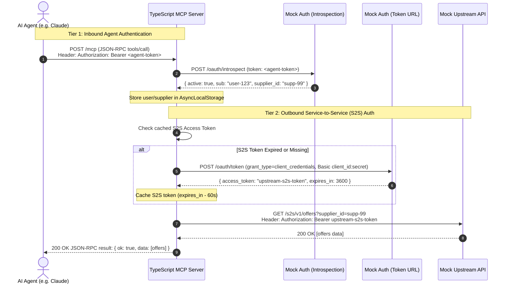
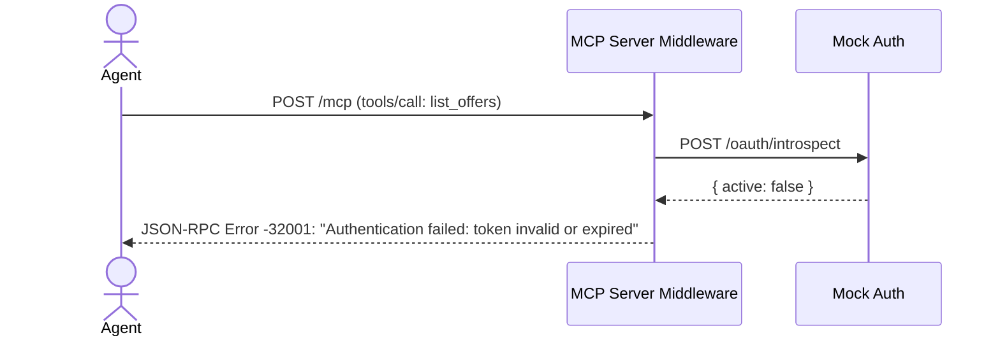
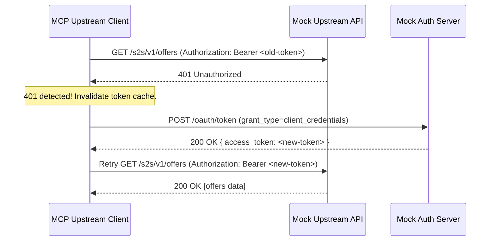

# 01. Architecture & Specifications

This chapter analyzes the system design, contrasts it with the Python reference repository (`visable/python-projects/supplier-backend-mcp-service`), and defines the exact technical specifications for your TypeScript implementation.

---

## 🔍 Python Reference vs. TypeScript Implementation

In the Python reference codebase, the architecture is structured as follows:

| Component             | Python Reference (`supplier-backend-mcp-service`)    | TypeScript Implementation (`typescript-mcp-server`) |
| --------------------- | ---------------------------------------------------- | --------------------------------------------------- |
| **MCP Runtime**       | `FastMCP` (Python SDK)                               | `@modelcontextprotocol/sdk` (Official TS SDK)       |
| **HTTP Transport**    | `FastAPI` (ASGI) + Streamable HTTP `/mcp`            | `Express` (or `Hono`) + SSE Transport               |
| **Request Context**   | `contextvars` (`_current_access_token`)              | Node.js `AsyncLocalStorage` (`RequestContext`)      |
| **Schema Validation** | `pydantic` (`Field`, `AliasChoices`)                 | `zod` (`z.object(...)`)                             |
| **HTTP Client**       | `httpx.AsyncClient`                                  | Native `fetch` (Node 20+) or `undici`               |
| **Inbound Auth**      | `TokenValidationMiddleware` (RFC 7662 Introspection) | Auth Middleware + `TokenIntrospector`               |
| **Outbound Auth**     | `ClientCredentialsTokenProvider`                     | `ClientCredentialsTokenProvider` (Promise-based)    |
| **Testing**           | `pytest` + `pytest-asyncio`                          | `vitest`                                            |

---

## 🔐 The Two-Tier Authentication Model

A critical concept in this project is understanding **why two different authentication flows exist**:



### Tier 1: Inbound Agent Authentication

- **Who is authenticating?** The AI Agent calling your MCP server.
- **Why?** Prevents unauthorized agents or unauthorized end-users from invoking supplier actions.
- **How is it passed?**
  1. _Transport Header_: `Authorization: Bearer <token>` on the HTTP/SSE connection.
  2. _Tool Argument_ (Optional fallback): `authToken: string` directly in the tool arguments.
- **Verification**: The MCP server validates the token against an RFC 7662 token introspection endpoint (or verifies a signed JWT). Upon successful validation, user claims (such as `supplierId` or `userId`) are bound to the current async execution context (`AsyncLocalStorage`).

### Tier 2: Outbound Service-to-Service (S2S) Authentication

- **Who is authenticating?** The MCP Server itself, presenting its own credentials to the Upstream Supplier API.
- **Why?** The upstream API does not trust or recognize the agent's inbound token; it only grants access to registered services via OAuth 2.0 Client Credentials Grant.
- **How is it handled?**
  - Uses `client_id` and `client_secret`.
  - POSTs to `/oauth/token`.
  - Returns a scoped Bearer token.
  - Caches the token in-memory with a clock skew margin (60s).
  - Handles automatic 401 retry (token invalidation).

---

## 🛠️ The 2 Tools Specification

To replicate the business patterns of `supplier-backend-mcp-service`, you will implement 2 core tools:

### Tool 1: `list_offers`

Lists and filters offers for a given supplier.

- **Description**: "List offers for a supplier with optional status filtering and pagination."
- **Input Parameters (Zod)**:
  ```typescript
  {
    supplierId: z.string().describe("Supplier ID whose offers to retrieve"),
    status: z.enum(["ACTIVE", "INACTIVE", "DRAFT"]).optional().describe("Filter by offer status"),
    page: z.number().int().min(1).default(1).describe("Page number (1-based)"),
    size: z.number().int().min(1).max(100).default(20).describe("Page size"),
    authToken: z.string().optional().describe("Optional Agent auth token if not provided in HTTP headers")
  }
  ```
- **Upstream Call**: `GET /s2s/v1/offers?supplier_id={supplierId}&status={status}&page={page}&size={size}`
- **Security Check**: When an inbound agent token is present, ensure the requested `supplierId` matches the authorized `supplier_id` claim in the agent's token (preventing unauthorized tenant access).

### Tool 2: `get_offer_by_id`

Fetches detailed attributes of a single offer.

- **Description**: "Fetch complete offer details by offer ID from the supplier backend."
- **Input Parameters (Zod)**:
  ```typescript
  {
    offerId: z.string().describe("Unique identifier of the offer"),
    authToken: z.string().optional().describe("Optional Agent auth token if not provided in HTTP headers")
  }
  ```
- **Upstream Call**: `GET /s2s/v1/offers/{offerId}`
- **Security Check**: Ensures the caller has a valid authenticated session before executing.

---

## 📦 Standardized Response Envelope

To prevent AI agent confusion, all MCP tools should return a consistent envelope structure (matching the pattern in `supplier-backend-mcp-service`):

### Success Response

```json
{
  "ok": true,
  "data": {
    "items": [
      {
        "id": "off-101",
        "title": "Industrial CNC Milling Machine",
        "status": "ACTIVE",
        "price": 24500.0,
        "currency": "EUR"
      }
    ],
    "pagination": { "page": 1, "size": 20, "total": 1 }
  },
  "error": null,
  "meta": {
    "operation": "list_offers",
    "request": { "supplier_id": "supp-99", "page": 1, "size": 20 }
  }
}
```

### Error Response

```json
{
  "ok": false,
  "data": null,
  "error": {
    "category": "upstream_http_error", // "auth_error" | "validation_error" | "transport_error"
    "message": "Offer off-999 not found",
    "status_code": 404
  },
  "meta": {
    "operation": "get_offer_by_id",
    "request": { "offer_id": "off-999" }
  }
}
```

---

## 🔄 Failure Scenarios & Edge Cases

### Case 1: Inbound Auth Failure

If the agent provides no token, or provides an invalid/expired token:



The request is aborted **before** any upstream call is made.

### Case 2: Outbound Upstream 401 Re-Authentication

If the upstream server expires the S2S token prematurely:



---

Next Step: **[02. Project Setup & Tooling](./02-project-setup-and-tooling.md)**
