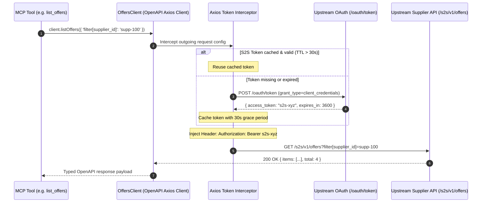

# 04. Outbound S2S OAuth & OpenAPI Client Architecture

In this chapter, you will implement the outbound communication layer between your MCP server and the upstream supplier service.

When an AI agent invokes an MCP tool (such as `list_offers` or `get_offer_by_id`), the MCP server acts as an authorized client. It must:
1. Obtain an Outbound S2S Bearer token via **OAuth 2.0 Client Credentials Grant** (RFC 6749 §4.4).
2. Call the upstream supplier APIs using a strongly-typed **OpenAPI client** (`openapi-client-axios`).

---

## 🏛️ End-to-End Outbound Architecture



---

## 🔑 Part 1: S2S OAuth Client Credentials Interceptor

Instead of manually writing low-level `fetch` wrappers and managing token cache expiration by hand, the outbound auth mechanism uses the **Axios Request Interceptor Pattern** powered by `axios-oauth-client` and `axios-token-interceptor`.

### File Location: `src/auth/client-credentials.ts`

```typescript
import axios, { type InternalAxiosRequestConfig } from "axios"
import { clientCredentials } from "axios-oauth-client"
import axiosTokenProvider from "axios-token-interceptor"

export interface OAuthClientCredentialsOptions {
  readonly tokenUrl: string
  readonly clientId: string
  readonly clientSecret: string
  readonly scope?: string
  readonly gracePeriodSeconds?: number
}

export interface TokenResponse {
  readonly access_token: string
  readonly token_type?: string
  readonly expires_in?: number
  readonly scope?: string
}

export type AxiosRequestInterceptor = (
  config: InternalAxiosRequestConfig,
) => Promise<InternalAxiosRequestConfig>

const DEFAULT_GRACE_PERIOD_SECONDS = 30

export function createOAuthInterceptor(
  options: OAuthClientCredentialsOptions,
): AxiosRequestInterceptor {
  const {
    tokenUrl,
    clientId,
    clientSecret,
    scope,
    gracePeriodSeconds = DEFAULT_GRACE_PERIOD_SECONDS,
  } = options

  // 1. Configure the OAuth client credentials fetcher
  const getCredentials: (scope?: string) => Promise<TokenResponse> =
    clientCredentials(
      axios.create(),
      tokenUrl,
      clientId,
      clientSecret,
      scope,
    )

  // 2. Wrap in an in-memory cache with safe TTL clock-skew handling
  const getToken = axiosTokenProvider.tokenCache<TokenResponse>(
    getCredentials,
    {
      getMaxAge: (response: TokenResponse): number => {
        const expiresInSeconds = response.expires_in ?? 3600 // fallback to 1 hour
        const safeLifetimeSeconds = Math.max(
          expiresInSeconds - gracePeriodSeconds,
          10,
        )
        return safeLifetimeSeconds * 1000 // milliseconds
      },
    },
  )

  // 3. Create the interceptor function that injects Authorization: Bearer <token>
  const provider = axiosTokenProvider({
    getToken,
    headerFormatter: (tokenData: unknown) => {
      const token = (tokenData as TokenResponse | null)?.access_token
      return token ? `Bearer ${token}` : ""
    },
  })

  return async (config) => {
    return (await provider(config)) as InternalAxiosRequestConfig
  }
}
```

### Key Responsibilities Handled:
- **Clock Skew (Grace Period)**: Refreshes the token 30 seconds before upstream expiration to prevent in-flight 401s.
- **In-Memory Caching**: Caches the token in memory across requests; `axios.create()` is called only when the token expires.
- **Header Injection**: Automatically formats and adds `Authorization: Bearer <token>` to all outgoing HTTP requests.

---

## 📐 Part 2: OpenAPI Client Generation Pipeline

To ensure compile-time type safety and avoid manual API path typos, the supplier client is generated directly from the OpenAPI specification using **`openapicmd`** and **`openapi-client-axios`**.

### 1. Schema Generation Scripts in `package.json`

```json
"scripts": {
  "schema:fetch:offers": "openapi read --bundle --dereference --json http://localhost:8080/openapi.json > ./src/gen/supplier-offers.openapi.json",
  "schema:runtime:offers": "openapi read --strip openapi_client_axios --dereference --remove-unreferenced --json ./src/gen/supplier-offers.openapi.json > ./src/gen/supplier-offers.openapi-runtime.json",
  "schema:types:offers": "openapi typegen --client ./src/gen/supplier-offers.openapi.json > src/types/supplier-offers.gen.d.ts",
  "schema:generate:offers": "npm run schema:fetch:offers && npm run schema:runtime:offers && npm run schema:types:offers"
}
```

### 2. Breakdown of the 3 Stages:

| Stage | Command | Purpose |
|---|---|---|
| **1. Fetch & Bundle** | `openapi read --bundle --dereference` | Resolves all internal/external `$ref` pointers into a single complete JSON schema. |
| **2. Runtime Optimization** | `openapi read --strip openapi_client_axios --remove-unreferenced` | Strips out markdown descriptions, schemas, and unused elements, reducing file size by 98% for lightweight runtime loading. |
| **3. Client Typegen** | `openapi typegen --client` | Generates TypeScript interfaces (`Client as OffersClient`, `OperationMethods`, parameters, and response bodies). |

---

## 🏭 Part 3: The Factory: `src/clients/offers.ts`

The factory function initializes the `OpenAPIClientAxios` instance, configures timeouts and base URLs, and attaches the OAuth token interceptor.

```typescript
import OfferClientDefinition from "@/gen/supplier-offers.openapi-runtime.json" with { type: "json" };
import type { Client as OffersClient } from "@/types/supplier-offers.gen";
import OpenAPIClientAxios from "openapi-client-axios";
import type { AxiosRequestInterceptor } from "../auth/client-credentials.js";

const DEFAULT_TIMEOUT_MS = 5000; // 5 seconds

export type OfferClientConfiguration = Omit<
  ConstructorParameters<typeof OpenAPIClientAxios>[0],
  "definition"
>;

export async function NewOffersClient(
  options?: OfferClientConfiguration,
  tokenProvider?: AxiosRequestInterceptor,
): Promise<OffersClient> {
  const api = new OpenAPIClientAxios({
    ...options,
    axiosConfigDefaults: {
      timeout: DEFAULT_TIMEOUT_MS,
      ...options?.axiosConfigDefaults,
    },
    definition: OfferClientDefinition,
  });

  const client = await api.init<OffersClient>();

  // Attach S2S OAuth token interceptor to client
  if (tokenProvider) {
    client.interceptors.request.use(tokenProvider);
  }

  return client;
}
```

---

## 🛠️ Part 4: Calling the Client in MCP Tools

Once initialized, MCP tools interact with the upstream API with 100% type safety and autocompletion:

```typescript
import { NewOffersClient } from "../clients/offers.js";
import { createOAuthInterceptor } from "../auth/client-credentials.js";
import { config } from "../config.js";

// 1. Create the S2S OAuth interceptor
const oauthInterceptor = createOAuthInterceptor({
  tokenUrl: config.UPSTREAM_OAUTH_TOKEN_URL,
  clientId: config.UPSTREAM_CLIENT_ID,
  clientSecret: config.UPSTREAM_CLIENT_SECRET,
  scope: "offers.read",
});

// 2. Instantiate the typed OpenAPI client
const offersClient = await NewOffersClient(
  {
    axiosConfigDefaults: {
      baseURL: config.UPSTREAM_BASE_URL,
    },
  },
  oauthInterceptor,
);

// 3. Fully typed method calls:
// Tool 1: List offers for supplier
const listResponse = await offersClient.listOffers({
  "filter[supplier_id]": "supp-100",
  page_size: 20,
});
console.log(listResponse.data);

// Tool 2: Get single offer by ID
const offerResponse = await offersClient.getOffer({
  offer_id: "off-101",
});
console.log(offerResponse.data);
```

---

## 🧪 Part 5: Testing Strategy

The outbound auth and client layers are verified with offline unit tests:
1. **Interceptor Tests** (`src/auth/client-credentials.test.ts`):
   - Header injection verification (`Authorization: Bearer <token>`).
   - In-memory cache hit (asserts token endpoint is invoked only once).
   - Clock-skew & TTL expiration simulation using `vi.useFakeTimers()`.
   - Fallback when `expires_in` is omitted.
2. **OpenAPI Client Integration Tests** (`src/clients/offers.test.ts`):
   - Mocks the underlying Axios adapter using `axios-mock-adapter` or Vitest spies.
   - Verifies path parameter injection (`/s2s/v1/offers/{offer_id}`) and query string serialization.

---

Next Step: **[05. Implementing the MCP Tools](./05-tools-implementation.md)**
