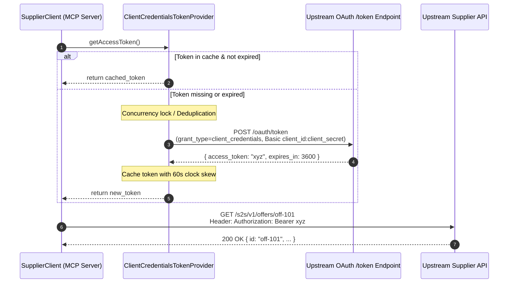

# 04. Outbound S2S OAuth Client Credentials Flow

In this chapter, you will implement the outbound authentication mechanism. When your MCP tools need to query or update data in the upstream supplier backend, the MCP server must authenticate as an authorized service using the **OAuth 2.0 Client Credentials Grant** (RFC 6749 §4.4).

---

## 🔑 Understanding the S2S Client Credentials Flow

Unlike user-facing authorization (Authorization Code grant), **Client Credentials** is designed for machine-to-machine (M2M) communication where no human is directly logging in:



---

## 🏗️ Implementing `ClientCredentialsTokenProvider`

Your token provider must handle three critical responsibilities:
1. **Clock Skew Margin**: Refresh the token *before* it actually expires (e.g., 60 seconds earlier) to ensure requests in transit never fail due to token expiry.
2. **Concurrency / Thundering Herd Prevention**: If 10 MCP tool requests arrive at the exact moment the cached token expires, your server should **not** make 10 simultaneous POST requests to `/oauth/token`. Instead, it should execute 1 token request and let all 10 callers await the same promise.
3. **Invalidation**: If the upstream API returns a 401 Unauthorized (e.g. server-side token revocation), allow callers to clear the cache and force a fresh token fetch.

### TypeScript Concurrency Pattern: Promise Deduplication
In Python, `asyncio.Lock()` is typically used. In TypeScript, an idiomatic pattern is **In-Flight Promise Sharing**:

```typescript
// Blueprint for src/oauth/client-credentials.ts
interface CachedToken {
  accessToken: string;
  expiresAt: number; // Unix timestamp in milliseconds
}

export class ClientCredentialsTokenProvider {
  private cache: CachedToken | null = null;
  private pendingPromise: Promise<string> | null = null;

  constructor(
    private tokenUrl: string,
    private clientId: string,
    private clientSecret: string,
    private scope?: string,
    private clockSkewSeconds: number = 60
  ) {}

  async getAccessToken(): Promise<string> {
    const now = Date.now();

    // 1. Return valid cached token if available
    if (this.cache && this.cache.expiresAt > now) {
      return this.cache.accessToken;
    }

    // 2. Prevent thundering herds: reuse in-flight token request
    if (this.pendingPromise) {
      return this.pendingPromise;
    }

    // 3. Initiate token fetch
    this.pendingPromise = this.fetchNewToken().finally(() => {
      this.pendingPromise = null;
    });

    return this.pendingPromise;
  }

  private async fetchNewToken(): Promise<string> {
    const basicAuth = Buffer.from(`${this.clientId}:${this.clientSecret}`).toString("base64");
    
    const body = new URLSearchParams({
      grant_type: "client_credentials",
    });
    if (this.scope) {
      body.append("scope", this.scope);
    }

    const response = await fetch(this.tokenUrl, {
      method: "POST",
      headers: {
        "Authorization": `Basic ${basicAuth}`,
        "Content-Type": "application/x-www-form-urlencoded",
        "Accept": "application/json",
      },
      body,
      signal: AbortSignal.timeout(10000), // 10s timeout
    });

    if (!response.ok) {
      const errorText = await response.text();
      throw new Error(`Failed to obtain client credentials token: ${response.status} - ${errorText}`);
    }

    const data = (await response.json()) as { access_token: string; expires_in?: number };
    if (!data.access_token) {
      throw new Error("OAuth token response did not contain access_token");
    }

    const expiresInSeconds = data.expires_in ?? 300;
    const ttlSeconds = Math.max(expiresInSeconds - this.clockSkewSeconds, 30);

    this.cache = {
      accessToken: data.access_token,
      expiresAt: Date.now() + ttlSeconds * 1000,
    };

    return this.cache.accessToken;
  }

  invalidate(): void {
    this.cache = null;
  }
}
```

---

## 🌐 The Upstream Base Client with 401 Retry

When communicating with upstream services, a `BaseClient` encapsulates:
- Attaching `Authorization: Bearer <token>`.
- Setting sensible timeouts (`AbortSignal.timeout(...)`).
- Catching unexpected `401 Unauthorized` responses, calling `provider.invalidate()`, and retrying once.

### Blueprint: `src/clients/base-client.ts`
```typescript
import { ClientCredentialsTokenProvider } from "../oauth/client-credentials.js";

export abstract class BaseClient {
  constructor(
    protected baseUrl: string,
    protected tokenProvider: ClientCredentialsTokenProvider
  ) {}

  protected async request<T>(
    path: string,
    options: RequestInit = {}
  ): Promise<T> {
    const url = new URL(path, this.baseUrl).toString();
    const headers = new Headers(options.headers);
    headers.set("Accept", "application/json");

    // 1. Inject Bearer token
    let token = await this.tokenProvider.getAccessToken();
    headers.set("Authorization", `Bearer ${token}`);

    let response = await fetch(url, {
      ...options,
      headers,
      signal: options.signal ?? AbortSignal.timeout(15000),
    });

    // 2. Automatic retry on 401 Unauthorized
    if (response.status === 401) {
      console.warn("Upstream returned 401. Invalidating token and retrying once...");
      this.tokenProvider.invalidate();
      token = await this.tokenProvider.getAccessToken();
      headers.set("Authorization", `Bearer ${token}`);

      response = await fetch(url, {
        ...options,
        headers,
        signal: options.signal ?? AbortSignal.timeout(15000),
      });
    }

    if (!response.ok) {
      const errorBody = await response.text();
      const error = new Error(`Upstream request failed: ${response.status} ${response.statusText}`);
      (error as any).statusCode = response.status;
      (error as any).body = errorBody;
      throw error;
    }

    return (await response.json()) as T;
  }
}
```

---

## 🏢 Implementing the `SupplierClient`

The `SupplierClient` extends `BaseClient` and exposes strongly typed methods for the 2 tools:

### Blueprint: `src/clients/supplier-client.ts`
```typescript
import { BaseClient } from "./base-client.js";

export interface Offer {
  id: string;
  supplierId: string;
  title: string;
  description: string;
  status: "ACTIVE" | "INACTIVE" | "DRAFT";
  price: number;
  currency: string;
  updatedAt: string;
}

export interface ListOffersParams {
  supplierId: string;
  status?: string;
  page?: number;
  size?: number;
}

export interface ListOffersResponse {
  items: Offer[];
  pagination: {
    page: number;
    size: number;
    total: number;
  };
}

export class SupplierClient extends BaseClient {
  async listOffers(params: ListOffersParams): Promise<ListOffersResponse> {
    const query = new URLSearchParams({
      supplier_id: params.supplierId,
      page: String(params.page ?? 1),
      size: String(params.size ?? 20),
    });
    if (params.status) {
      query.append("status", params.status);
    }

    return this.request<ListOffersResponse>(`/s2s/v1/offers?${query.toString()}`, {
      method: "GET",
    });
  }

  async getOfferById(offerId: string): Promise<Offer> {
    return this.request<Offer>(`/s2s/v1/offers/${encodeURIComponent(offerId)}`, {
      method: "GET",
    });
  }
}
```

---

Next Step: **[05. Implementing the 2 MCP Tools](./05-tools-implementation.md)**
