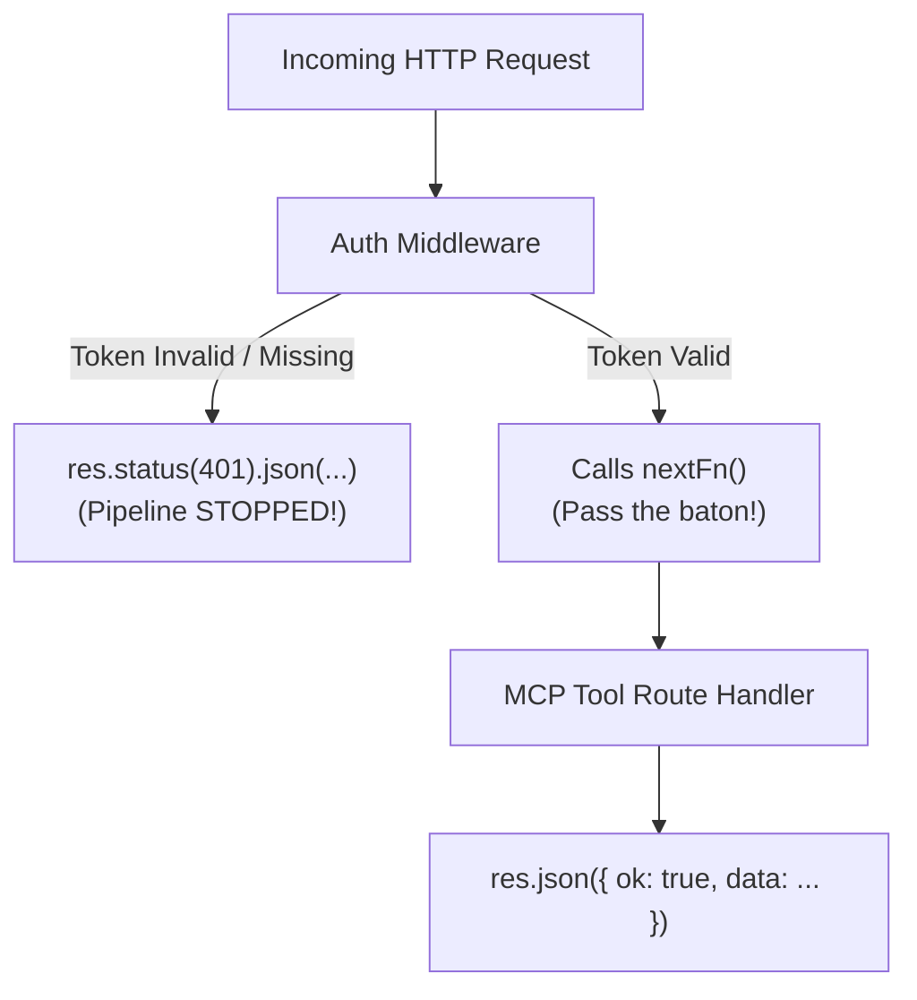

# Express Middleware Testing: `nextFn` & TypeScript Double Assertions

When testing Express middleware like `createAuthMiddleware` in Vitest, you encounter two foundational concepts:

1. **The role of `nextFn`** in the Express pipeline and how to assert it in unit tests.
2. **Why TypeScript requires a "double assertion" (`as unknown as Response`)** when mocking complex objects, and safer alternatives like `Partial<Response>`.

---

## Part 1: What is `nextFn`? (The Relay Race Baton) 🏃💨

Express is architected around the **Chain of Responsibility Pattern** (a pipeline of middleware functions).

When a request arrives, Express routes it through a sequential chain of checkpoints:



---

### 1. In Production Runtime:

- **`nextFn()`** (usually named `next`) is the **"baton pass"**.
- If authentication succeeds: the middleware calls `nextFn()`, signaling Express:
  > _"I have verified this user. Advance the request to the next middleware or route handler in line."_
- If authentication fails: the middleware sends an error response (e.g., HTTP 401) and **never calls `nextFn()`**. This deliberately halts the pipeline, ensuring unauthorized callers never reach your business tools.

---

### 2. In Unit Tests (`auth-middleware.test.ts`):

In tests, you pass a Vitest spy:

```typescript
const mockNext = vi.fn()
```

This enables you to verify your security boundaries with precision:

#### A. Security Verification (Negative Test)

If the token is invalid or missing, `nextFn` must **never** be invoked:

```typescript
it("blocks unauthorized requests", async () => {
  await middleware(unauthorizedReq, mockRes, mockNext)

  expect(mockRes.status).toHaveBeenCalledWith(401)
  expect(mockNext).not.toHaveBeenCalled() // 🛡️ Guaranteed pipeline halt!
})
```

#### B. Authorization Verification (Positive Test)

If the token is valid, `nextFn` must be called exactly once:

```typescript
it("allows authorized requests through", async () => {
  await middleware(authorizedReq, mockRes, mockNext)

  expect(mockNext).toHaveBeenCalledTimes(1) // 🏁 Baton successfully passed!
})
```

#### C. Context Verification Inside `nextFn`

Because our middleware executes `RequestContext.run(session, () => nextFn())`, you can inspect that the async context is actively populated _during_ the execution of `nextFn`:

```typescript
let sessionInsideNext: AgentSession | undefined

const nextFn = vi.fn(() => {
  sessionInsideNext = RequestContext.current()
})

await middleware(req, mockRes, nextFn)

expect(sessionInsideNext).toEqual(validSession) // 🎯 Proof of context propagation!
```

---

## Part 2: Understanding `as unknown as Response` (Double Assertion) 🎭

### 1. Why Direct Casting (`as Response`) Fails

In Express, a real `Response` object is massive. It contains over **80+ built-in methods and properties**:
`res.send()`, `res.cookie()`, `res.redirect()`, `res.setHeader()`, `res.locals`, `res.writeHead()`, `res.render()`, etc.

In your unit test, you only need to mock the two methods your middleware actually uses:

```typescript
const mockRes = {
  status: vi.fn().mockReturnThis(),
  json: vi.fn().mockReturnThis(),
}
```

If you try to write a direct type cast:

```typescript
const res = mockRes as Response // ❌ TYPESCRIPT BLOCKS THIS!
```

TypeScript throws:

> `Conversion of type '{ status: Mock; json: Mock; }' to type 'Response' may be a mistake because neither type sufficiently overlaps with the other.`

### The Rule: Structural Overlap

TypeScript only permits direct casting (`A as B`) if `A` is a subtype of `B`, or `B` is a subtype of `A`. Because our mock object is missing 98% of `Response`'s required methods, TypeScript assumes this is a serious developer bug and blocks it.

---

### 2. The Escape Hatch: The "Unknown Bridge"

TypeScript has a special universal top type called **`unknown`**.

```
{ status, json }  ──(Step 1: as unknown)──▶  unknown  ──(Step 2: as Response)──▶  Response
```

1. **Step 1 (`as unknown`)**: Every type in TypeScript can be assigned to `unknown`. TypeScript allows this widening without objection.
2. **Step 2 (`as Response`)**: Once a value is typed as `unknown`, TypeScript allows you to assert it to _any specific type_.

By chaining both (`as unknown as Response`), you tell the compiler:

> _"I know 78 methods are missing. Trust me, this code only executes `status` and `json` during this test."_

---

### 3. The Danger of Double Assertion

Because `as unknown as Response` completely disables TypeScript's safety checks, if you make a typo in your mock object:

```typescript
const mockRes = {
  staus: vi.fn(), // 👈 Notice typo: "staus" instead of "status"!
  json: vi.fn(),
} as unknown as Response // 🙈 TypeScript stays silent!
```

TypeScript will not warn you, and your test will crash at runtime with `TypeError: res.status is not a function`.

---

### 4. Cleaner & Safer Alternatives

#### Alternative A: `Partial<Response>` (Type-Safe Mocking) ⭐

Instead of double assertion, use TypeScript's built-in `Partial<T>` utility type:

```typescript
// Partial<Response> means: "Any object with a subset of Response properties"
const mockRes: Partial<Response> = {
  status: vi.fn().mockReturnThis(), // ✅ TypeScript autocompletes and verifies spelling!
  json: vi.fn().mockReturnThis(),
}

// Now casting to Response is clean and verified:
await middleware(req, mockRes as Response, mockNext)
```

If you misspell `staus`, TypeScript will catch it immediately before you even run the test!

#### Alternative B: `vitest-mock-extended` (Deep Auto-Mocking)

For large enterprise test suites, libraries like `vitest-mock-extended` create fully typed mocks automatically:

```typescript
import { mock } from "vitest-mock-extended"

const mockRes = mock<Response>()
mockRes.status.mockReturnThis()

// mockRes is a 100% type-valid Response with all 80+ methods mocked!
await middleware(req, mockRes, mockNext)
```

---

## 💡 Summary

| Concept                      | What It Does                             | Why We Use It                                                                     |
| ---------------------------- | ---------------------------------------- | --------------------------------------------------------------------------------- |
| **`nextFn()`**               | Advances the Express middleware pipeline | Tested to verify that unauthorized requests halt and authorized requests proceed. |
| **`as Response`**            | Direct type cast                         | Blocked by TypeScript due to missing required properties on the mock.             |
| **`as unknown as Response`** | Double assertion (escape hatch)          | Bypasses structural type checks by passing through the `unknown` bridge.          |
| **`Partial<Response>`**      | Sub-set type assertion                   | Recommended: keeps autocomplete and spell-checking on mock methods.               |
