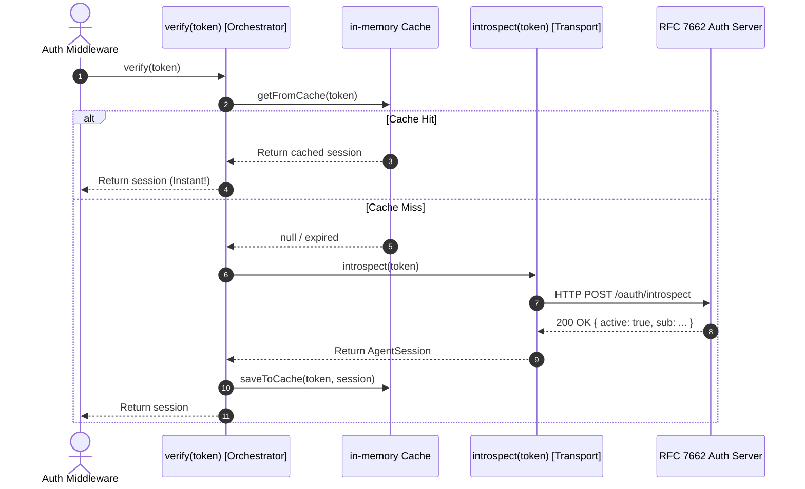

# Token Verification Architecture: Separation of Concerns & The Cache-Aside Pattern

When designing an authentication service like `TokenIntrospector`, a common architectural question arises:

> *"Should the HTTP call to the RFC 7662 introspection endpoint be placed directly inside `verify()`, or should it be separated into its own method or class?"*

This guide analyzes why separating the network transport from caching orchestration aligns with the **Single Responsibility Principle (SRP)** and mirrors the design of enterprise services like the Python reference project (`supplier-backend-mcp-service`).

---

## 1. The Architectural Problem: Mixing Concerns

If the HTTP request is placed directly inside `verify()`, that single function takes on **two completely different responsibilities**:

```
                       ┌────────────────────────────────────────────────────────┐
                       │          Monolithic verify(token) Method               │
                       ├────────────────────────────────────────────────────────┤
Responsibility 1       │ • Generates SHA-256 hash of token                      │
(Caching & Logic)      │ • Checks in-memory cache for existing session          │
                       │ • Checks expiration timestamp                          │
                       ├────────────────────────────────────────────────────────┤
Responsibility 2       │ • Formats application/x-www-form-urlencoded body       │
(HTTP & Protocol)      │ • Dispatches HTTP POST via fetch()                     │
                       │ • Handles timeouts with AbortSignal                    │
                       │ • Parses RFC 7662 JSON response                        │
                       ├────────────────────────────────────────────────────────┤
Responsibility 1 again │ • Calculates cache TTL with cap                        │
(Caching & Logic)      │ • Saves verified session to Map                        │
                       └────────────────────────────────────────────────────────┘
```

### Why this is a code smell:
- **High Coupling**: If your authentication server changes its URL format or headers tomorrow, you are editing the caching function.
- **Harder to Test**: You cannot test caching rules (hits, misses, TTLs) without also setting up mock HTTP responses.
- **Poor Readability**: The high-level business flow (*"check cache ➔ fetch if missing ➔ return"*) gets lost in 40 lines of HTTP configuration and error handling.

---

## 2. The Solution: The Cache-Aside Pattern

The **Cache-Aside Pattern** (also called Lazy Loading) is an industry-standard caching architecture. The orchestrator checks the cache first; if the data is missing, it delegates fetching to a dedicated provider and writes the result back to cache.



---

## 3. How the Python Reference Repo Solved This

In the reference repository ([`app/auth.py`](file:///Users/atifanowar/Workspace/visable/python-projects/supplier-backend-mcp-service/app/auth.py)), this separation was enforced at the **class level**:

1. **`TokenIntrospector`**: Sole responsibility is HTTP communication:
   ```python
   class TokenIntrospector:
       async def introspect(self, token: str) -> AccessToken | None:
           # Strictly POSTs to introspection_url and parses claims
   ```
2. **`CachedTokenVerifier`**: Sole responsibility is caching and orchestration:
   ```python
   class CachedTokenVerifier:
       def __init__(self, introspector: TokenIntrospector, ttl: int, ...):
           self._introspector = introspector
           
       async def verify(self, token: str) -> AccessToken | None:
           # Checks Redis / in-memory cache
           # Calls self._introspector.introspect() on miss
   ```

This is the **Decorator Pattern**. It completely decouples caching technology (which could be Redis, in-memory, or Memcached) from the HTTP protocol.

---

## 4. Decomposing `TokenIntrospector` in TypeScript

Even when keeping both responsibilities inside a single class for simplicity, extracting the network call into a dedicated `private introspect()` method provides immediate benefits:

```typescript
export class TokenIntrospector {
  private readonly cache = new Map<string, CacheEntry>();

  constructor(
    private readonly introspectionUrl: string,
    private readonly cacheTtlSeconds: number = 300,
    private readonly timeoutMs: number = 5_000
  ) {}

  /**
   * 1. Orchestrator (Cache-Aside):
   * Clean, high-level business logic.
   */
  async verify(token: string): Promise<AgentSession | null> {
    if (!token) return null;

    // Check cache first
    const cached = this.getFromCache(token);
    if (cached) return cached;

    // Fetch from auth server on miss
    const session = await this.introspect(token);
    if (!session) return null;

    // Store in cache for subsequent requests
    this.saveToCache(token, session);
    return session;
  }

  /**
   * 2. Dedicated Network Layer:
   * Responsible ONLY for the RFC 7662 HTTP exchange.
   */
  private async introspect(token: string): Promise<AgentSession | null> {
    try {
      const response = await fetch(this.introspectionUrl, {
        method: "POST",
        headers: {
          "Content-Type": "application/x-www-form-urlencoded",
          "Accept": "application/json",
        },
        body: new URLSearchParams({ token, token_type_hint: "access_token" }),
        signal: AbortSignal.timeout(this.timeoutMs),
      });

      if (!response.ok) return null;

      const body = (await response.json()) as IntrospectionResponse;
      if (!body.active) return null;

      return {
        token,
        userId: body.sub ?? "unknown",
        supplierId: body.supplier_id ?? "",
        scopes: body.scope ? body.scope.split(" ") : [],
        expiresAt: body.exp ? body.exp * 1000 : undefined,
      };
    } catch {
      return null;
    }
  }

  // 3. Cache Helpers (Private encapsulation)
  private getFromCache(token: string): AgentSession | null {
    const key = this.hashToken(token);
    const entry = this.cache.get(key);
    if (entry && entry.expiresAt > Date.now()) {
      return entry.session;
    }
    return null;
  }

  private saveToCache(token: string, session: AgentSession): void {
    const key = this.hashToken(token);
    const ttlMs = Math.min(this.cacheTtlSeconds, 3600) * 1000;
    this.cache.set(key, { session, expiresAt: Date.now() + ttlMs });
  }

  private hashToken(token: string): string {
    return crypto.createHash("sha256").update(token).digest("hex");
  }
}
```

---

## 🎯 Architectural Benefits Summary

| Metric | Monolithic `verify()` | Separated `verify()` + `introspect()` |
|---|---|---|
| **Readability** | 40+ lines mixing HTTP and cache logic | `verify()` is just 8 lines of pure orchestrator logic |
| **Separation of Concerns** | Mixed responsibilities | Clear boundary between Cache logic and Network logic |
| **Maintainability** | Editing HTTP headers risks breaking cache | Network changes never impact caching rules |
| **Extensibility** | Hard to switch to Redis or external caches | Trivial to extract `introspect()` into its own class |
