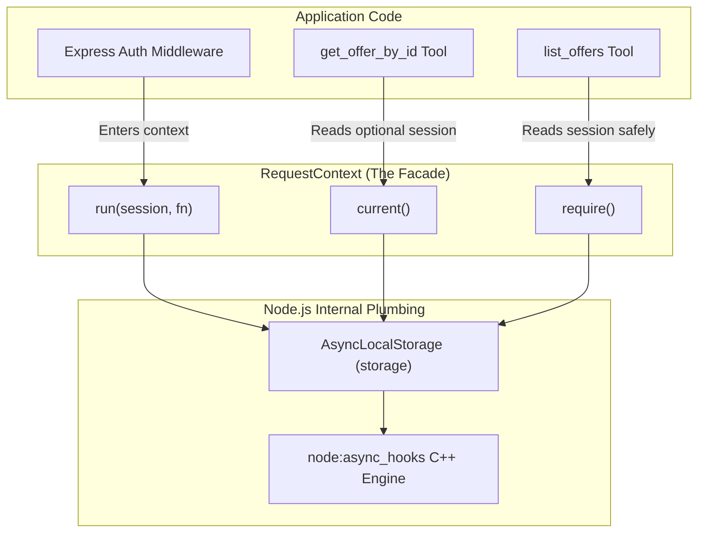

# Understanding `RequestContext`: Object Literal vs. Class & The Facade Pattern

This guide explains what the `RequestContext` construct represents, why it is written as a plain JavaScript object instead of a `class`, and how it implements the **Facade Pattern** over `AsyncLocalStorage`.

---

## 🔬 The Code in Question

```typescript
export const RequestContext = {
  /** Run an async callback within an authenticated session context */
  run<T>(session: AgentSession, callback: () => Promise<T>): Promise<T> {
    return storage.run(session, callback)
  },

  /** Get the current authenticated agent session (or undefined if unauthenticated) */
  current(): AgentSession | undefined {
    return storage.getStore()
  },

  /** Require an active session or throw an error */
  require(): AgentSession {
    const session = storage.getStore()
    if (!session) {
      throw new Error("Unauthorized: No authenticated agent session found.")
    }
    return session
  },
}
```

---

## 1. What is it Syntactically?

Syntactically, `RequestContext` is **neither a class nor a code block**. It is a **plain JavaScript Object Literal** containing functions as properties.

In JavaScript and TypeScript:

```typescript
const MyObject = {
  myMethod() { ... }
};
```

When exported, this object functions as a **Static Namespace / Module**. You invoke its methods using dot notation:

```typescript
RequestContext.run(session, callback)
const session = RequestContext.current()
```

---

## 2. Could It Have Been Written as a `class`?

**Yes!** If you are accustomed to Java, C#, or Python OOP patterns, you might naturally write this as a class with `static` methods:

```typescript
// The Traditional OOP Class Pattern:
export class RequestContext {
  private constructor() {} // Prevent instantiation

  static run<T>(session: AgentSession, callback: () => Promise<T>): Promise<T> {
    return storage.run(session, callback)
  }

  static current(): AgentSession | undefined {
    return storage.getStore()
  }

  static require(): AgentSession {
    const session = storage.getStore()
    if (!session) {
      throw new Error("Unauthorized: No authenticated agent session found.")
    }
    return session
  }
}
```

---

## 3. Why Modern TypeScript Favors the Object Literal

While both approaches result in identical caller syntax (`RequestContext.current()`), modern TypeScript strongly prefers the **plain object literal** (or standalone exported functions) over static-only classes:

| Feature                            | `const RequestContext = { ... }`                 | `class RequestContext { static ... }`                 |
| ---------------------------------- | ------------------------------------------------ | ----------------------------------------------------- |
| **Syntax Boilerplate**             | Minimal and clean                                | Verbose (`class`, `static`, private constructor)      |
| **Accidental `new` Instantiation** | Impossible (`new RequestContext()` throws error) | Possible unless you remember `private constructor()`  |
| **Compiled JavaScript**            | Emits a lightweight standard object in `dist/`   | Emits an entire ES6 class declaration with prototypes |
| **Idiomatic TypeScript**           | Standard JavaScript-native module design         | Java-ism (unnecessary class packaging)                |

---

## 4. What Does It Represent Architecturally? (The Facade Pattern)

Architecturally, `RequestContext` is an implementation of the **Facade Pattern**.

Instead of exposing the raw `storage` instance (`new AsyncLocalStorage()`) directly across the codebase, `RequestContext` creates a safe, simplified interface that wraps it:



### The 3 Core Benefits of this Facade:

1. **Information Hiding**:
   Your tool handlers and middleware don't need to know that `node:async_hooks` or `AsyncLocalStorage` even exists. If you ever switch storage engines in the future, you only change this one file.

2. **Self-Documenting API**:
   - `storage.getStore()` is vague (what store?).
   - `RequestContext.current()` is clear and expresses domain intent.

3. **Guards Against `undefined` Runtime Bugs (`require()`)**:
   Calling `storage.getStore()` returns `undefined` if unauthenticated, which leads to `TypeError: Cannot read properties of undefined (reading 'supplierId')`.  
   `RequestContext.require()` guarantees a non-null session or immediately throws a clean, descriptive authentication error.

---

## 5. Deconstructing the Generic Signature: `run<T>`

Notice this method signature:

```typescript
run<T>(session: AgentSession, callback: () => Promise<T>): Promise<T>
```

### Why `<T>` is Used Here:

- `T` is a generic type representing the **return value** of whatever function is passed into `callback`.
- If your callback returns a number (`Promise<number>`), `run<T>` returns `Promise<number>`.
- If your callback returns an array of offers (`Promise<Offer[]>`), `run<T>` preserves that exact type!
- **Without `<T>`**, you would be forced to return `Promise<any>` or `Promise<unknown>`, losing all TypeScript type safety.
