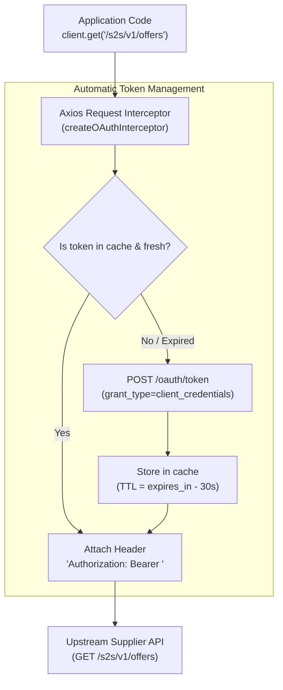

# OAuth 2.0 Client Credentials with Axios: Interceptor & Token Cache Pattern

When communicating with upstream services that require machine-to-machine (M2M) authentication, manually fetching an access token and injecting `Authorization: Bearer <token>` into every individual HTTP call is error-prone and repetitive.

This guide details the **Axios Request Interceptor Pattern** using `axios-oauth-client` and `axios-token-interceptor` to fully automate Outbound S2S OAuth 2.0 Client Credentials authentication in TypeScript.

---

## 🏛️ Architecture & Mental Model

An **Axios Request Interceptor** acts like an outgoing middleware checkpoint for your HTTP client:



Once attached, your business methods (`listOffers()`, `getOfferById()`) never touch token logic; the interceptor quietly handles all authentication and caching underneath.

---

## 📦 The 3 Cooperating Libraries

1. **`axios`**: The primary HTTP client.
2. **`axios-oauth-client`** (`oauth.clientCredentials`):
   - Implements the RFC 6749 OAuth 2.0 Client Credentials Grant.
   - Formats `grant_type=client_credentials` and uses HTTP Basic Auth (`client_id:client_secret`).
   - Returns a dedicated fetch function: `() => Promise<TokenResponse>`.
3. **`axios-token-interceptor`**:
   - **`tokenCache`**: In-memory caching wrapper preventing redundant network calls to `/oauth/token`.
   - **Interceptor Generator**: Formats the `Bearer <token>` string and mutates `config.headers.Authorization`.

---

## 🌟 Idiomatic TypeScript Implementation

```typescript
import axios, { type InternalAxiosRequestConfig } from "axios"
import oauth from "axios-oauth-client"
import axiosTokenProvider from "axios-token-interceptor"

export interface TokenResponse {
  readonly access_token: string
  readonly token_type?: string
  readonly expires_in?: number
  readonly scope?: string
}

export interface OAuthClientCredentialsOptions {
  readonly tokenUrl: string
  readonly clientId: string
  readonly clientSecret: string
  readonly scope?: string
  readonly gracePeriodSeconds?: number
}

export type AxiosRequestInterceptor = (
  config: InternalAxiosRequestConfig,
) => Promise<InternalAxiosRequestConfig>

const DEFAULT_GRACE_PERIOD_SECONDS = 30

/**
 * Creates an Axios request interceptor that automatically authenticates
 * outgoing requests using OAuth 2.0 Client Credentials and an in-memory token cache.
 */
export function createOAuthInterceptor(
  options: OAuthClientCredentialsOptions,
): AxiosRequestInterceptor {
  const {
    tokenUrl,
    clientId,
    clientSecret,
    scope,
    gracePeriodSeconds = DEFAULT_GRACE_PERIOD_SECONDS,
  } = options

  // 1. Correctly typed: getCredentials returns a PROMISE of TokenResponse
  const getCredentials: (scope?: string) => Promise<TokenResponse> =
    oauth.clientCredentials(
      axios.create(), // Dedicated isolated axios instance strictly for token exchange
      tokenUrl,
      clientId,
      clientSecret,
      scope,
    )

  // 2. Token Cache with defensive TTL calculation
  const getToken = axiosTokenProvider.tokenCache<TokenResponse>(
    () => getCredentials(),
    {
      getMaxAge: (response: TokenResponse): number => {
        // Fallback to 1 hour (3600s) if server omits expires_in (prevents NaN bugs)
        const expiresInSeconds = response.expires_in ?? 3600
        const safeLifetimeSeconds = Math.max(
          expiresInSeconds - gracePeriodSeconds,
          10,
        )
        return safeLifetimeSeconds * 1000
      },
    },
  )

  // 3. Create the interceptor with null-safe header formatting
  const provider = axiosTokenProvider({
    getToken,
    headerFormatter: (tokenData: unknown) => {
      const token = (tokenData as TokenResponse | null)?.access_token
      return token ? `Bearer ${token}` : ""
    },
  })

  return async (config) => {
    return (await provider(config)) as InternalAxiosRequestConfig
  }
}
```

---

## 🔍 Key TypeScript & Reliability Improvements

### 1. Correct Async Type Signature (`Promise<TokenResponse>`)

In untyped examples, `getCredentials` is often mistakenly typed as returning a synchronous `TokenResponse`. Because network I/O is asynchronous, typing it as `(scope?: string) => Promise<TokenResponse>` accurately represents the Promise lifecycle.

---

### 2. Defensive `getMaxAge` Math (Preventing `NaN` Cache Bugs)

In RFC 6749, the `expires_in` property is **optional**.

```typescript
// ⚠️ DANGEROUS: If expires_in is undefined, (undefined - 30) * 1000 === NaN!
getMaxAge: (res) => (res.expires_in - 30) * 1000
```

When `getMaxAge` evaluates to `NaN`, the cache immediately considers the token expired on every single request, defeating the entire purpose of the cache.  
Our refactored implementation uses **nullish coalescing (`??`)** and a safety floor:

```typescript
const expiresInSeconds = response.expires_in ?? 3600
const safeLifetimeSeconds = Math.max(expiresInSeconds - gracePeriodSeconds, 10)
```

---

### 3. Idiomatic `camelCase` & `readonly` Immutability

- Properties in JavaScript and TypeScript follow standard **`camelCase`** (`tokenUrl`, `clientId`) rather than `snake_case`.
- Properties on `OAuthClientCredentialsOptions` and `TokenResponse` are marked **`readonly`** to guarantee compile-time immutability.

---

### 4. `import type` for Production Tree-Shaking

```typescript
import axios, { type InternalAxiosRequestConfig } from "axios"
```

In modern TypeScript (especially with `"moduleResolution": "NodeNext"`), using `type InternalAxiosRequestConfig` informs the compiler that this symbol is purely a type and should be 100% stripped from compiled output in `dist/`.

---

## 🚀 How to Use in Business Clients (`SupplierClient`)

```typescript
import axios, { AxiosInstance } from "axios"
import { createOAuthInterceptor } from "./oauth-interceptor.js"

export class SupplierClient {
  private readonly client: AxiosInstance

  constructor(
    baseUrl: string,
    oauthConfig: { tokenUrl: string; clientId: string; clientSecret: string },
  ) {
    this.client = axios.create({
      baseURL: baseUrl,
      timeout: 10_000,
    })

    // 🎯 Register the interceptor ONCE during client construction:
    this.client.interceptors.request.use(createOAuthInterceptor(oauthConfig))
  }

  // Business methods contain ZERO token logic:
  async listOffers(supplierId: string) {
    const response = await this.client.get("/s2s/v1/offers", {
      params: { supplier_id: supplierId },
    })
    return response.data
  }

  async getOfferById(offerId: string) {
    const response = await this.client.get(`/s2s/v1/offers/${offerId}`)
    return response.data
  }
}
```

---

## 💡 Summary Comparison

| Metric                     | Manual Custom Fetch Implementation                  | Axios Interceptor Pattern                                  |
| -------------------------- | --------------------------------------------------- | ---------------------------------------------------------- |
| **Lines of Code**          | ~100 lines (mutex lock, custom cache, 401 retry)    | ~30 lines (using battle-tested community interceptors)     |
| **Separation of Concerns** | Mixed into base client classes                      | Interceptor is completely decoupled from business logic    |
| **Developer Experience**   | Must remember to call `getToken()` on every request | 100% automatic: call `client.get()` and tokens are handled |
| **Token Caching**          | Manual `Map` with custom eviction                   | Managed by `axios-token-interceptor` with clock skew       |
