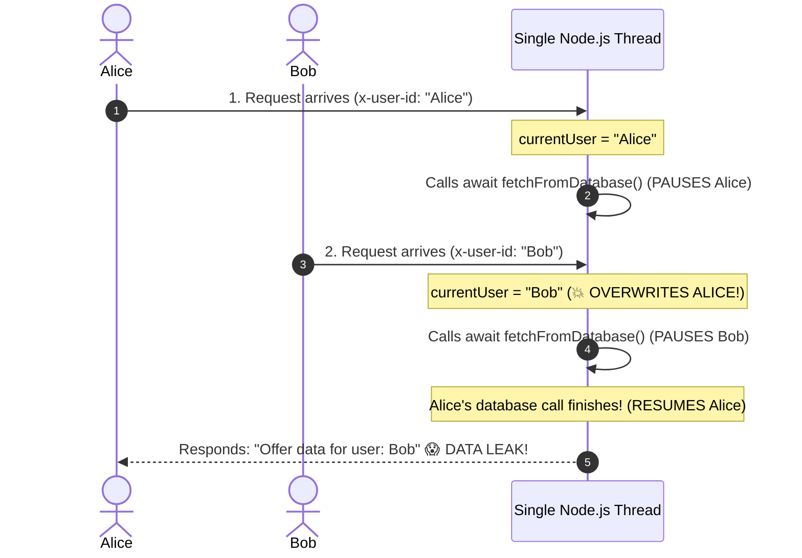

# Understanding `AsyncLocalStorage`: Async State Isolation in Node.js

This guide explains what **`AsyncLocalStorage`** is, what *"isolating state per async execution chain"* means, how it works under the hood, and why it is critical for building our MCP Server.

---

## ⚡ The Executive Summary

> **`AsyncLocalStorage` is the Node.js equivalent of "Thread-Local Storage". It lets you store request-scoped data (like an authenticated user or agent token) that automatically follows an asynchronous execution chain without having to manually pass it as an argument through every function signature.**

---

## 💥 The Disaster: Why Global Variables Fail in Node.js

Node.js is **single-threaded**. It handles thousands of simultaneous requests on an **Event Loop** by pausing and resuming operations at every `await`.

Imagine you store the current authenticated user in a global variable:

```typescript
// ❌ CRITICAL BUG: Global variable in a concurrent server
let currentUser: string | null = null;

app.get("/offer", async (req, res) => {
  currentUser = req.headers["x-user-id"] as string; // 1. Set global user

  const offer = await fetchFromDatabase(); // 2. PAUSE (waiting for I/O)

  // 3. RESUME
  res.send(`Offer data for user: ${currentUser}`);
});
```

Here is what happens when two users (Alice and Bob) make requests at nearly the same millisecond:



### The Problem
Because there is only one thread, **Bob's request overwrote Alice's global variable** while Alice was paused at `await`. When Alice resumed, she received Bob's data!

---

## 🔗 What is an "Async Execution Chain"?

When a request arrives, every function call, `await`, Promise, or timer it spawns forms a **family tree** called an **asynchronous execution chain**:

```
Request 1 Chain (Alice):
[Incoming HTTP Request]
     │
     └──▶ [Auth Middleware]
               │
               └──▶ [toolHandler()]
                         │
                         └──▶ [await fetchUpstream()] ──▶ [Send Response to Alice]

Request 2 Chain (Bob):
[Incoming HTTP Request]
     │
     └──▶ [Auth Middleware]
               │
               └──▶ [toolHandler()]
                         │
                         └──▶ [await fetchUpstream()] ──▶ [Send Response to Bob]
```

Even though Alice and Bob pause, resume, and interleave on the exact same CPU thread, their **async execution chains** are completely distinct trees of Promises.

---

## 🛡️ The Solution: `AsyncLocalStorage`

`AsyncLocalStorage` creates a **storage container that travels down an async execution chain**.

- You initialize the store using `storage.run(data, callback)`.
- That `data` is attached **exclusively to that chain**.
- No matter how many times your code pauses at `await`, or how many other concurrent requests hit the server, **the data never leaks to other requests**.

```typescript
import { AsyncLocalStorage } from "node:async_hooks";

interface Session {
  userId: string;
}

// 1. Create the storage container
const asyncLocalStorage = new AsyncLocalStorage<Session>();

app.get("/offer", (req, res) => {
  const userId = req.headers["x-user-id"] as string;

  // 2. Run the request inside an isolated session
  asyncLocalStorage.run({ userId }, async () => {
    // 3. Any asynchronous function down the chain can read the store!
    const data = await getOfferDetails();
    res.json(data);
  });
});

async function getOfferDetails() {
  await someDatabaseCall(); // Pauses and resumes...

  // 4. Retrieve the store: Alice gets Alice, Bob gets Bob!
  const session = asyncLocalStorage.getStore();
  return { user: session?.userId, item: "CNC Milling Machine" };
}
```

---

## ⚙️ How Does It Work Under the Hood?

`AsyncLocalStorage` is built directly into Node's C++ core using the **`node:async_hooks`** engine API:

1. **`asyncId` Tracking**:
   Node.js assigns an internal unique numeric identifier (`asyncId`) to every asynchronous resource (every Promise, timer, file read, or network socket).
2. **Parent-Child Link (`triggerAsyncId`)**:
   Whenever a Promise creates another Promise (e.g. `await fetch()`), Node records the parent ID (`triggerAsyncId`) that created it.
3. **Context Propagation**:
   When you call `asyncLocalStorage.run(store, callback)`, Node maps that `store` object reference to the current `asyncId`. As new child Promises are spawned down the chain, Node automatically passes the pointer down the tree to all child operations.
4. **Automatic Context Switching**:
   When the Event Loop switches execution from Alice's paused Promise to Bob's Promise, Node's C++ engine automatically swaps the active storage reference in memory.

---

## 🌍 Language Comparison: How Different Languages Solve This

| Language | Execution Model | Solution |
|---|---|---|
| **Java** | Multi-threaded (1 thread per request) | `ThreadLocal<T>` |
| **C# (.NET)** | Task-based asynchronous pattern | `AsyncLocal<T>` |
| **Python** | Asyncio Event Loop | `contextvars.ContextVar` *(used in your reference repo!)* |
| **Node.js** | Single-threaded Event Loop | `node:async_hooks` ➔ `AsyncLocalStorage` |

> [!NOTE]
> In the Python reference project (`app/context.py`), you saw:
> ```python
> _current_access_token: contextvars.ContextVar[AccessToken | None] = contextvars.ContextVar(...)
> ```
> `AsyncLocalStorage` in Node.js is the **exact direct counterpart** to Python's `contextvars.ContextVar`.

---

## 🎯 How We Use It in Our MCP Server

In our MCP Server ([`src/context/request-context.ts`](./../03-inbound-agent-auth.md)):

1. When an AI Agent invokes an MCP tool, our HTTP middleware verifies the Bearer token and extracts the `supplierId`:
   ```typescript
   RequestContext.run(session, () => {
     next();
   });
   ```
2. Deep inside your tool handlers ([`src/tools/list-offers.ts`](./../05-tools-implementation.md)):
   ```typescript
   const session = RequestContext.current();
   ```
3. Even if 100 AI Agents are concurrently querying offers for 100 different suppliers, each tool execution is **guaranteed** to see only its own authenticated tenant session.
