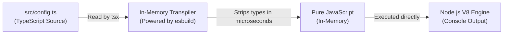

# Understanding `npx` and `tsx`: How We Run TypeScript Files

When you run:

```bash
npx tsx src/config.ts
```

Two distinct tools are working together in harmony:

```
npx                   tsx                   src/config.ts
 ▲                     ▲                         ▲
 │                     │                         └─ The file to execute
 │                     └─ The TypeScript runner (transpiles in memory)
 └─ The package executor (finds the local binary)
```

---

## 1. What is `npx`? (Node Package eXecutor)

`npx` comes pre-installed with `npm` (since npm v5.2). It is an **executable runner for Node packages**.

### The Problem `npx` Solves:

When you run `npm install -D tsx`, npm installs the executable binary into:

```
node_modules/.bin/tsx
```

Because `node_modules/.bin` is **not** in your computer's global shell `$PATH`, if you simply type:

```bash
tsx src/config.ts
```

Your terminal will likely return:

```
zsh: command not found: tsx
```

### How `npx` Fixes This:

1. **Runs local project binaries**: When you prefix a command with `npx`, it automatically searches your project's `node_modules/.bin/` directory first and runs it directly.
   - Without `npx`: `./node_modules/.bin/tsx src/config.ts` (annoying to type!)
   - With `npx`: `npx tsx src/config.ts` (clean and portable!)
2. **Runs one-off packages without installing them**: If a package is _not_ installed in your project, `npx` downloads it to a temporary cache, executes it once, and cleans up.
   - Example: `npx @modelcontextprotocol/inspector` (runs the MCP Inspector UI without permanently adding it to your `package.json`).

---

## 2. What is `tsx`? (TypeScript eXecute)

Node.js is a JavaScript runtime. It natively only understands pure JavaScript (`.js`). If you try running a TypeScript file with standard Node:

```bash
node src/config.ts
```

Node will crash with a syntax error because it does not recognize TypeScript syntax (`interface`, `: string`, `import` without extensions, etc.).

### What `tsx` does:

`tsx` is an ultra-fast CLI tool built specifically to **execute TypeScript files directly in Node.js on the fly**.



### Why `tsx` is the modern choice:

1. **Powered by `esbuild`**: It strips types in memory in less than 10 milliseconds.
2. **No disk clutter**: It never writes any `.js` files to your hard drive (unlike `tsc`).
3. **Flawless ESM (`NodeNext`) Support**: Older tools like `ts-node` are notorious for breaking with modern ESM imports. `tsx` handles modern ESM seamlessly.
4. **Built-in Watch Mode**: Running `npx tsx watch src/index.ts` automatically reloads your server whenever you save a file.

---

## ⚖️ Tool Comparison: `npm` vs `npx` & `node` vs `tsx` vs `tsc`

### `npm` vs `npx`

| Command   | What it does                                  | Example                 |
| --------- | --------------------------------------------- | ----------------------- |
| **`npm`** | Manages packages (installs, removes, updates) | `npm install zod`       |
| **`npx`** | Executes binaries inside `node_modules/.bin`  | `npx tsx src/config.ts` |

### `node` vs `tsc` vs `tsx` vs `tsup`

| Tool       | Purpose                           | Writes files to disk?        | Speed                        |
| ---------- | --------------------------------- | ---------------------------- | ---------------------------- |
| **`node`** | Runs compiled JavaScript          | No                           | ⚡ Instant (JavaScript only) |
| **`tsc`**  | Type-checks code                  | Yes (unless `--noEmit`)      | 🐢 Slow (checks all types)   |
| **`tsx`**  | Runs TypeScript in development    | ❌ No (transpiles in memory) | ⚡⚡ Blazing fast            |
| **`tsup`** | Bundles TypeScript for production | ✅ Yes (`dist/index.js`)     | ⚡⚡ Blazing fast            |

---

## 💡 Pro-Tip: When Do You NOT Need `npx`?

When you define scripts inside your [**`package.json`**](../../../package.json):

```json
"scripts": {
  "dev": "tsx watch src/index.ts",
  "mock": "tsx watch mock-upstream/server.ts"
}
```

NPM automatically injects `node_modules/.bin` into the path when executing npm scripts!
Therefore, inside `package.json`, you write `"tsx watch ..."` **without** `npx`. You only type `npx` when running ad-hoc commands directly in your terminal.
